# Rapport de Projet : Kafka et Spring Cloud Stream

**Réalisé par : Wissal Biyi**  
**Établissement : ENSET Mohammedia**  
**Filière : Big Data et Cloud Computing**

---

## 1. Introduction

Ce projet consiste à développer une application de traitement d’événements en temps réel avec **Apache Kafka**, **Spring Boot** et **Spring Cloud Stream**.

Les événements représentent des consultations de pages. Ils sont publiés dans des topics Kafka, consommés par l’application et exploités pour produire des résultats analytiques affichés dans une interface Web.

Les principales réalisations comprennent :

- La mise en place de Kafka et ZooKeeper avec Docker.
- Le test de publication et de consommation avec les outils console Kafka.
- La création d’un service Producer accessible par un contrôleur REST.
- La création d’un service Consumer pour recevoir les événements.
- La création d’un Supplier pour générer automatiquement des événements.
- Le traitement des événements avec Kafka Streams.
- L’affichage des résultats analytiques dans une application Web.

---

## 2. Architecture du Projet

L’architecture repose sur Kafka pour assurer les échanges entre les producteurs, les consommateurs et le traitement analytique.

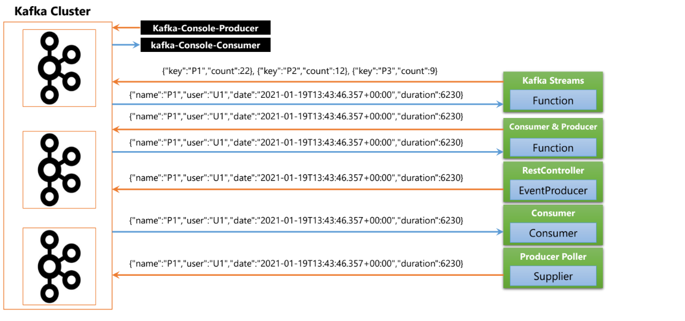

Les principaux composants sont :

- **RestController** : déclenche la publication d’un événement à partir d’une requête HTTP.
- **Consumer** : reçoit les événements et les affiche dans la console.
- **Supplier** : génère automatiquement des événements.
- **Kafka Streams** : traite les événements et calcule les résultats analytiques.
- **Application Web** : affiche les résultats sous forme de courbes.

---

## 3. Validation de l’environnement Kafka

### A. Vérification des conteneurs

La commande suivante permet de vérifier les conteneurs en cours d’exécution :

```powershell
docker ps
```

La capture montre les conteneurs **bdcc-kafka-broker** et **bdcc-zookeeper** avec le statut **Up**.

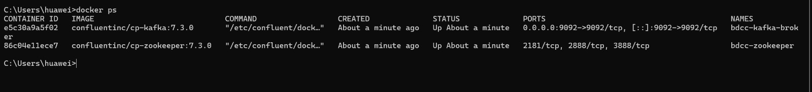

### B. Publication des messages dans T1

Le producteur console permet de saisir des messages et de les publier dans le topic **T1** :


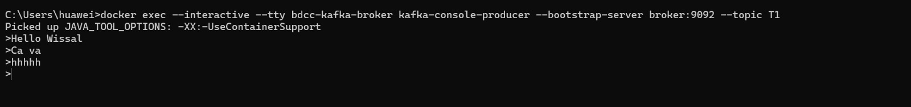

### C. Consommation des messages de T1

Dans un autre terminal, le consommateur est lancé avec la commande :

```powershell
docker exec -it bdcc-kafka-broker kafka-console-consumer --bootstrap-server localhost:9092 --topic T1
```

Les messages publiés sont affichés dans le terminal du consommateur.

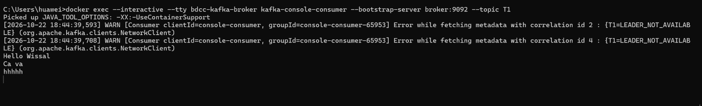

### D. Relecture des messages avec from-beginning

L’option **--from-beginning** permet de relire les messages encore conservés depuis le début du topic lorsqu’aucun offset de groupe existant ne prend priorité.


La capture montre la récupération des messages précédemment publiés.

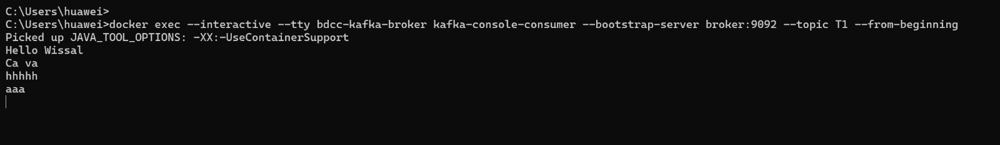

---

## 4. Service Producer via un contrôleur REST

Le service Producer permet de publier un événement dans Kafka à partir d’une requête HTTP.

### A. Test du contrôleur REST

L’URL utilisée pour publier un événement relatif à la page **P1** dans le topic **T2** est :

```text
http://localhost:8081/publish/T2/P1
```

Le contrôleur retourne un événement JSON contenant les champs suivants :

- **name** : nom de la page.
- **user** : identifiant de l’utilisateur.
- **date** : date de l’événement.
- **duration** : durée associée à l’événement.

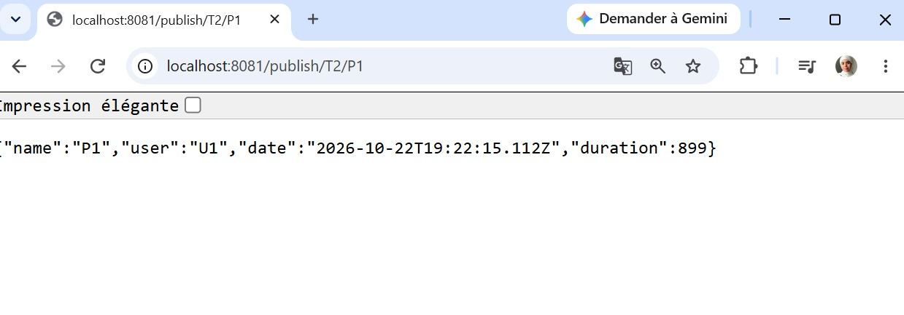

### B. Vérification de la réception dans T2

Un consommateur console est lancé pour observer les événements du topic **T2** :

```powershell
docker exec -it bdcc-kafka-broker kafka-console-consumer --bootstrap-server localhost:9092 --topic T2
```

La capture montre un événement reçu au format JSON.

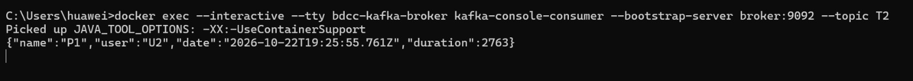

Les captures du navigateur et du terminal illustrent deux publications distinctes, avec des valeurs différentes pour l’utilisateur, la date et la durée.

---

## 5. Service Consumer Kafka

Le Consumer Spring reçoit les événements Kafka sous forme d’objets **PageEvent** et les affiche dans la console de l’application.


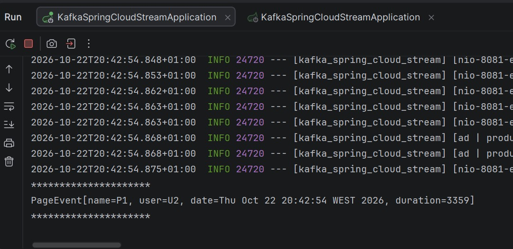

Ce test illustre la réception et l’affichage d’un événement par le Consumer de l’application.

---

## 6. Service Supplier Kafka

Le Supplier génère automatiquement des événements sans nécessiter une requête HTTP pour chaque publication.

Les événements observés contiennent :

- Des pages **P1** ou **P2**.
- Des utilisateurs **U1** ou **U2**.
- Une date de génération.
- Une durée variable.

### Test du Supplier

Le consommateur console est abonné au topic **T3** :

```powershell
docker exec -it bdcc-kafka-broker kafka-console-consumer --bootstrap-server localhost:9092 --topic T3
```

Les messages apparaissent successivement, avec un intervalle d’environ une seconde dans la capture.

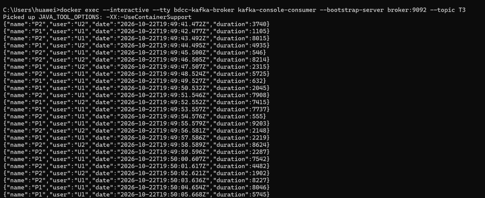

Ce résultat illustre la génération et la publication périodiques des événements.

---

## 7. Traitement analytique avec Kafka Streams

Le service analytique exploite les événements pour suivre l’activité des pages en temps réel.

Le principe du traitement consiste à :

1. Lire le flux d’événements.
2. Regrouper les événements par page.
3. Calculer des valeurs de comptage.
4. Exposer les résultats à l’application Web.

Les résultats observés associent les pages **P1** et **P2** à des valeurs numériques.

### Consultation du flux analytique

Les résultats sont accessibles à l’adresse :

```text
http://localhost:8082/analytics
```


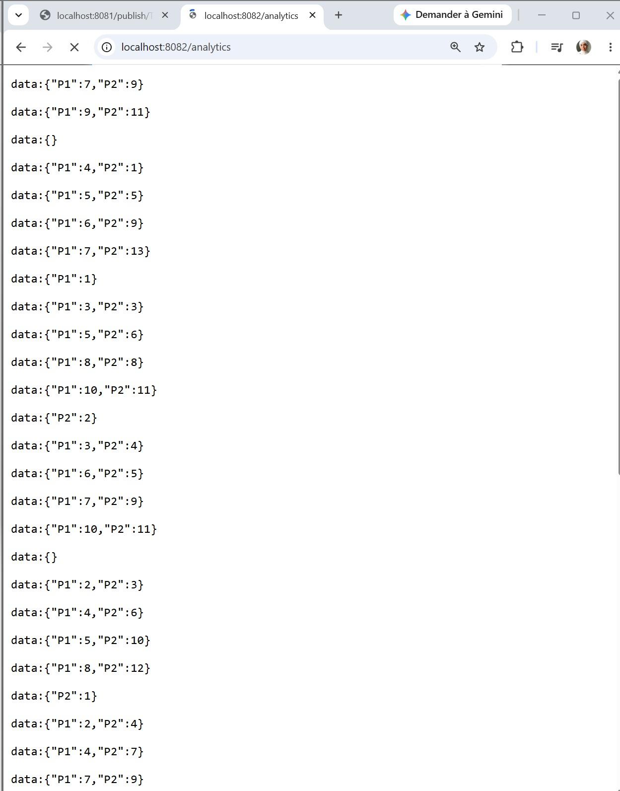

Le préfixe **data:** correspond au format utilisé pour transmettre des événements avec **Server-Sent Events**.

Les valeurs évoluent et reviennent parfois à de faibles nombres. Elles ne doivent donc pas être interprétées comme des compteurs cumulés depuis le démarrage. Le paramétrage exact des fenêtres temporelles reste à confirmer dans le code source.

---

## 8. Application Web de visualisation

L’application Web présente les résultats analytiques sous forme de courbes.

### Accès à l’interface

```text
http://localhost:8082/index.html
```

L’interface affiche deux séries de résultats et permet de suivre leur évolution pendant l’exécution.

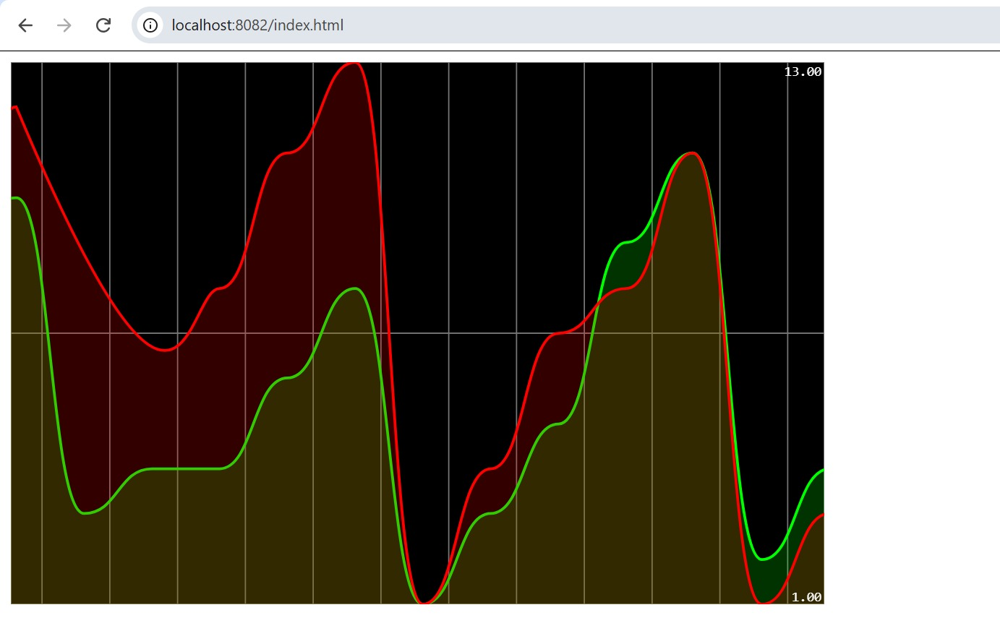

La capture montre deux courbes, rouge et verte. L’absence de légende ne permet pas d’attribuer avec certitude chaque couleur à une page.

---


---

## 9. Conclusion

Ce projet a permis de mettre en pratique une chaîne de traitement d’événements avec **Kafka**, **Spring Boot** et **Spring Cloud Stream**.

Les tests réalisés illustrent la publication des messages, leur consommation, la génération automatique d’événements et l’exploitation des résultats dans une interface Web.

L’utilisation de Kafka permet aux producteurs et aux consommateurs de fonctionner de manière découplée, tandis que Kafka Streams apporte les mécanismes de traitement nécessaires à l’analyse du flux.

---

## 10. Références

- [Vidéo du professeur](https://www.youtube.com/watch?v=8uY7JE_X_Fw)
- [Guide Kafka avec Docker indiqué dans la consigne](https://developer.confluent.io/quickstart/kafka-docker/)